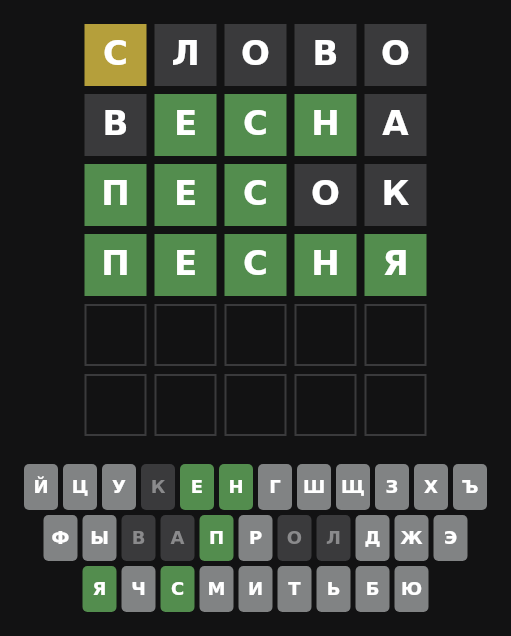
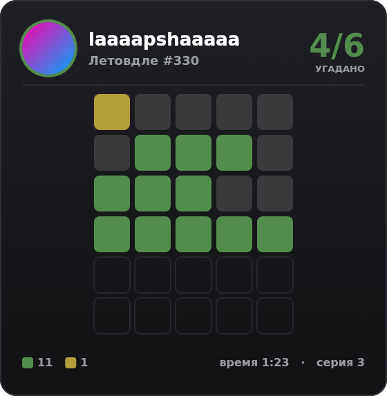

# Летовдле — русский Wordle для Discord

Бот с командой `/letodle`, как Wordle в Discord, только на русском. Нужно угадать слово из 5 букв за 6 попыток.
Поле рисуется картинкой (плитки и клавиатура ЙЦУКЕН), а догадки вводятся через всплывающее окно.

 

## Что умеет

| Команда | Что делает |
|---|---|
| `/letodle день` (`daily`) | Слово дня: одно на всех, меняется в полночь по Москве, одна игра в сутки |
| `/letodle тренировка` (`practice`) | Случайное слово, играть можно сколько угодно |
| `/letodle статистика` (`stats`) | Сыграно, % побед, серия, распределение попыток |
| `/letodle правила` (`rules`) | Как играть |

* 🟩 буква на своём месте, 🟨 буква есть, но в другом месте, ⬛ буквы нет. Повторяющиеся буквы считаются честно, как в оригинале.
* **Е и Ё — одна буква**: можно вводить как удобно.
* Поле видно только игроку (эфемерное сообщение), поэтому никто не подсмотрит. После игры кнопка **«Поделиться»** публикует в чат картинку-карточку: аватарка и ник игрока, номер игры, счёт, время и серия, сетка без букв (без спойлеров).
* Принимаются только реальные слова (~28 тыс. словоформ), загадываются ~640 обычных существительных.
* Команда работает на серверах, в личке с ботом и (если включить «User Install») в любых чатах.
* Прогресс и статистика сохраняются в `data/state.json` и переживают перезапуск.

## Запуск

Нужен Node.js 18.17+.

1. Создай приложение на <https://discord.com/developers/applications>, во вкладке **Bot** получи токен.
2. Пригласи бота: **OAuth2 → URL Generator**, scopes `bot` и `applications.commands`. Особых прав не нужно (хватит «Send Messages»).
3. Установи зависимости и заполни настройки:
   ```bash
   npm install
   cp .env.example .env   # впиши DISCORD_TOKEN и CLIENT_ID (и GUILD_ID для теста на своём сервере)
   ```
4. Зарегистрируй слэш-команду (один раз и после изменения `src/commands.js`):
   ```bash
   npm run deploy
   ```
5. Запусти бота:
   ```bash
   npm start
   ```

Привилегированные интенты (Message Content и т.п.) **не нужны**.

### Если у тебя уже есть бот на discord.js

Можно не запускать отдельного бота, а подключить игру к своему:

```js
const { Store } = require('./letovdle/src/game/store');
const { createHandlers } = require('./letovdle/src/bot');
const { commands } = require('./letovdle/src/commands'); // добавь к своим командам при регистрации

const letodle = createHandlers(new Store());
client.on('interactionCreate', letodle.handle); // реагирует только на /letodle и свои кнопки
```

## Разработка

```bash
npm test                         # тесты логики и обработчиков
npm run preview -- слово песня   # нарисовать поле в preview.png
```

Структура:

```
src/
  index.js            запуск бота
  commands.js         описание /letodle
  deploy-commands.js  регистрация команды
  bot.js              обработка команд, кнопок и окна ввода
  game/engine.js      правила: проверка догадки, победа/поражение
  game/words.js       словари, ё→е, слово дня
  game/render.js      картинка поля
  game/card.js        карточка результата для «Поделиться»
  game/store.js       сохранение игр и статистики
data/
  answers.txt         слова, которые загадываются (можно править)
  valid.txt           все допустимые догадки
```

Чтобы добавить или убрать загадываемые слова, просто отредактируй `data/answers.txt` (по слову в строке). Слово дня выбирается детерминированно из этого списка.

`index.html` — прежняя браузерная версия игры, её бот не трогает.

## Словарь

Список допустимых слов собран из словаря [OpenCorpora](http://opencorpora.org/) (через пакет `pymorphy3-dicts-ru`), без имён собственных, аббревиатур и обсценной лексики. Данные OpenCorpora распространяются по лицензии CC BY-SA.
